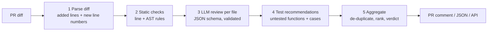

# AI-Assisted Code Review Platform

A multi-step review workflow for pull requests. It combines deterministic checks with an LLM
reviewer that must return structured, validated findings, recommends concrete tests for changed
functions, and posts one consolidated comment on the pull request from GitHub Actions. Each step is
also exposed as its own FastAPI service, packaged with Docker, and CI builds the image and calls every
service on each push.



**Design choices**

* **Only changed lines.** Every finding must point at a line added in the diff. LLM findings on any
  other line are dropped and counted, so a hallucinated line number never reaches the PR.
* **Rules first, model second.** Static rules are cheap, explainable and always on; their findings
  are passed to the model so it focuses on what rules cannot see (logic, intent) instead of repeating them.
* **Structured output.** The model must return JSON matching a schema (line, severity, category,
  message, suggestion, confidence). Invalid output is logged in the trace and the review continues.
* **Tests as part of the review.** Functions that are new or changed without a matching test in the
  same PR get concrete test cases derived from the code: optional parameters, defaults, raised
  exceptions, loops, branches, division.
* **Advice, not a gate.** The comment supports a human reviewer. A `--fail-on high` flag can turn it
  into a CI gate if a team wants that.

## Example comment

For a PR that adds `examples/bad_code.py` (static checks only, no API key):

| | Location | Category | Finding | Suggestion |
|---|---|---|---|---|
| 🔴 | `app/bad_code.py:7` | security | Hard-coded credential in source code. | Load it from an environment variable or a secrets manager. |
| 🔴 | `app/bad_code.py:16` | security | Running a shell command built from strings allows command injection. | Pass a list of arguments with `shell=False`... |
| 🟠 | `app/bad_code.py:11` | reliability | HTTP call without a timeout can hang forever. | Add `timeout=`. |
| 🟠 | `app/bad_code.py:23` | correctness | Mutable default argument in `add_tag` is shared between calls. | Default to `None`... |
| 🟡 | `app/bad_code.py:19` | testing | `average` is new but no test in this change covers it. | Suggested cases include *divisor of zero* |

The static rules do not see that `average([])` divides by zero; the test advisor suggests the test
that would catch it, and the LLM step is there to flag it directly.

## Evaluation

`eval/cases.py` holds 20 small pull requests with 35 labelled issues: security, error handling,
correctness, reliability, maintainability, missing tests, plus 5 issues **no static rule targets**
(an off-by-one, a division by zero, a wrong formula, an unclosed file and an indirect SQL injection)
and 4 clean PRs to measure false positives. A finding matches when file and category match and the
line is within 1.

Results for **static checks + test advisor** (`python eval/run_eval.py`, no API key):

| Scope | Precision | Recall |
|---|---|---|
| All findings | 1.00 | 0.86 (30 of 35) |
| Excluding test-coverage findings | 1.00 | 0.74 (14 of 19) |
| Issues no static rule targets | n/a | 0 of 5 |
| Clean PRs with any false positive | 0 of 4 | |

How to read this honestly:

* The rules and the cases were written by the same person, so static recall here is an optimistic
  upper bound, not a measure of real-world coverage.
* Clean case C18 (a docstring saying "never eval()") was flagged by the first, regex-only version of
  the `eval` rule. It is now an AST check, which removed that false positive.
* The 5 static-blind issues are the case for the LLM step. Run `python eval/run_eval.py --llm` with an
  API key to measure how many it finds and at what precision; results are written to `eval/results/llm/`.

## Quick start

```bash
pip install -r requirements.txt
python -m pytest                                       # 14 tests (the API test runs when FastAPI is installed)
python eval/run_eval.py                                # seeded-defect evaluation

# review a diff
git diff main...HEAD | python -m reviewer.cli review - --repo .
python -m reviewer.cli review examples/sample.diff --format json
python -m reviewer.cli review --git origin/main --repo . --fail-on high

# with the LLM step
pip install anthropic && export ANTHROPIC_API_KEY=...   # or: pip install openai, OPENAI_API_KEY
python -m reviewer.cli review examples/sample.diff

# API (interactive docs at http://localhost:8001/docs)
uvicorn reviewer.api:app --port 8001

# Docker
docker compose up --build                              # same API on http://localhost:8001
```

## API services

Each step of the workflow is a separate FastAPI router in `reviewer/services/`, mounted by
`reviewer/api.py`, so a pipeline can call just the step it needs:

| Service | Endpoint | Returns |
|---|---|---|
| Diff | `POST /diff/parse` | files, language, added lines, hunks |
| Static checks | `POST /checks/static` | rule findings on changed lines |
| Test advisor | `POST /checks/tests` | untested functions and suggested test cases |
| Full review | `POST /review` | verdict, ranked findings, tests, step trace (LLM step if a key is set) |
| Full review | `POST /review/markdown` | the PR comment as Markdown |
| Health | `GET /health` | `{"status": "ok"}` |

All POST endpoints take `{"diff": "<unified diff>"}`; `/review` also takes `"use_llm": true|false`.

## GitHub Actions

* `.github/workflows/ci.yml`: lint, tests and the seeded-defect evaluation on every push, then a
  Docker job that builds the image, starts the container and calls every service (build validation).
* `.github/workflows/ai-review.yml`: on every pull request, reviews the diff against the base branch
  and posts (or updates) a single comment. It works without any secrets using static checks; add an
  `ANTHROPIC_API_KEY` repository secret to enable the LLM step.

To see it working: create a branch, copy `examples/bad_code.py` to `app/bad_code.py`, push and open
a pull request.

## Project structure

```
reviewer/
  diff.py           1 parse unified diffs (added lines with new-file line numbers)
  static.py         2 line and AST rules (docs/RULES.md)
  llm.py            3 LLM review with JSON schema validation and line checks
  tests_advisor.py  4 untested functions and suggested test cases
  workflow.py       5 orchestration, aggregation, verdict, trace
  render.py         PR comment (Markdown)
  github.py         create or update the PR comment (standard library only)
  services/         FastAPI routers: diff, static checks, test advisor, full review
  api.py            FastAPI app mounting the services
  cli.py
Dockerfile, docker-compose.yml
eval/cases.py, eval/run_eval.py
examples/           sample diff, sample review, deliberately flawed file for a demo PR
```

## Limitations

* Static rules cover Python only; other languages get the LLM step only.
* Line rules see one line at a time: a SQL string built over several lines (case C19) is missed.
* Test recommendations check whether a test file in the same PR mentions the function name; they do
  not measure coverage.
* The LLM step is implemented and unit-tested with a fake model; its evaluation needs an API key.

Licence: MIT
